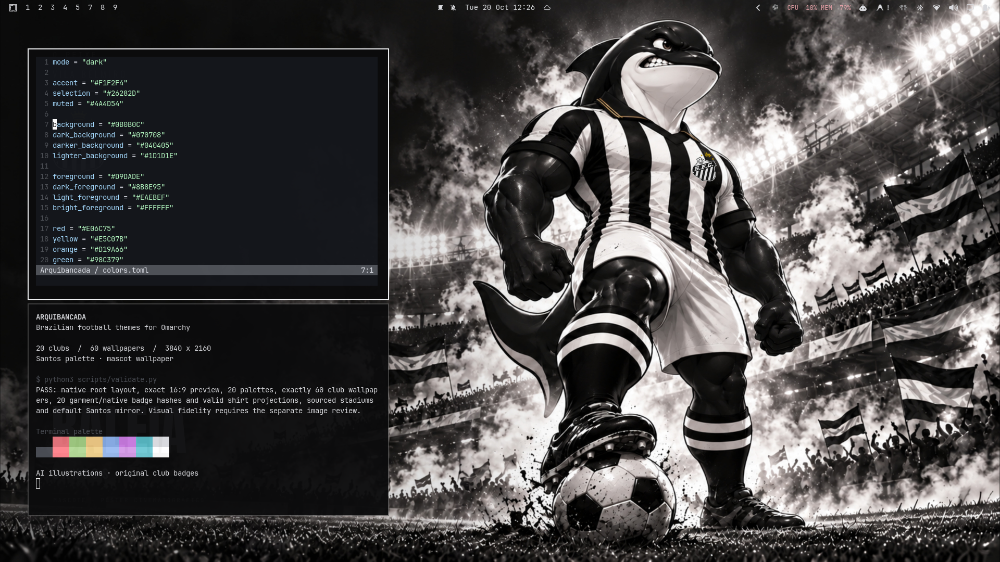

# Arquibancada

[English](README.md) | [Português (Brasil)](README.pt-BR.md)

Omarchy themes for the 20 clubs in the 2026 Brazilian Série A. Each club has its
own interface and terminal palette, three 3840×2160 wallpapers, a preview,
icons and a keyboard color.

I made this collection for the Brazilian Omarchy community and for supporters
who want their club's colors on the desktop. None of the images represents my
personal club preference. The order of the clubs and the default theme do not
indicate which team I support.



[View all 20 mascot wallpapers](docs/mascotes-serie-a-2026.jpg).

## Installation

Clone the collection and install the club themes:

```bash
gh repo clone JohnRenatoDev/omarchy-arquibancada-theme
cd omarchy-arquibancada-theme
./install.sh --link --menu
```

The installer adds the club themes to Omarchy. The menu option adds missing club
entries and backs up the existing menu before changing it. Existing local themes
stored as independent directories are preserved; running the installer again
with the same options does not duplicate menu entries.

```bash
./install.sh --link --menu   # instala os 20 e completa o menu Clubes
omarchy theme set flamengo  # exemplo; use qualquer slug da tabela
omarchy theme bg next       # alterna os três wallpapers
```

Use `./install.sh --copy` if you prefer a self-contained copy. Each club has its
own preview in Omarchy's theme picker.

To install just the default Santos variant through Omarchy, run:

```bash
omarchy theme install https://github.com/JohnRenatoDev/omarchy-arquibancada-theme.git
```

That installs a single theme named `arquibancada`. To get all 20 clubs, use
`install.sh` from the cloned repository.

## Clubs

The club list was checked against the [CBF team list](https://www.cbf.com.br/futebol-brasileiro/times/campeonato-brasileiro/serie-a/2026)
and ESPN's team feed on October 19, 2026. The artwork has no season or championship
numbers, so it can still be used beyond 2026.

| Command / theme | Club | Mascot |
|---|---|---|
| `santos` | Santos | Baleia |
| `corinthians` | Corinthians | Mosqueteiro |
| `palmeiras` | Palmeiras | Periquito |
| `sao-paulo` | São Paulo | Santo Paulo |
| `athletico-paranaense` | Athletico | Fura-Cão |
| `atletico-mineiro` | Atlético-MG | Galo |
| `bahia` | Bahia | Homem de Aço |
| `botafogo` | Botafogo | Bira |
| `chapecoense` | Chapecoense | Guerreiro Condá |
| `coritiba` | Coritiba | Vovô Coxa |
| `cruzeiro` | Cruzeiro | Raposão |
| `flamengo` | Flamengo | Urubu |
| `fluminense` | Fluminense | Guerreiro |
| `gremio` | Grêmio | Mosqueteiro |
| `internacional` | Internacional | Saci |
| `mirassol` | Mirassol | Leão |
| `red-bull-bragantino` | Bragantino | Toro Loko |
| `remo` | Remo | Leão Azul |
| `vasco` | Vasco da Gama | Almirante |
| `vitoria` | Vitória | Leão |

## Wallpapers

1. `1-arte.jpg`: an abstract composition with the club's colors, monogram and typography.
2. `2-escudo.jpg`: the club crest, with lighting and colors from the theme.
3. `3-mascote.jpg`: a cinematic sports poster with the club's kit and shirt emblem.

The mascot illustrations were generated with AI. We took care with each club's
uniforms and symbols, using references to make artwork its supporters could
recognize and enjoy. Each mascot has its own design, in a shared cinematic,
semirealistic cartoon style. Internacional's Saci stands on his single leg and
holds the ball in his arm.

The base illustrations are 1672×941, proportionally enlarged to 3840×2160 without
cropping the character or ball. Typography and original club badges are added
separately at the final resolution.

See the [wallpaper catalog](docs/preview.png), [kit references](docs/uniformes-2026.md)
and [stadium sources](docs/estadios.md). The [artwork and build notes](docs/development.md)
explain the composition and list the source files.

## Contributing

Anyone is welcome to open a pull request to fix or improve a theme. A misplaced
crest, a kit detail or a color that looks wrong is worth correcting. Contributions
to the wallpapers and installer are welcome too.

If you support one of these clubs, your eye for its details helps. Include a
reference image or a before-and-after preview when you can.

## Development

You need Python 3, ImageMagick, `rsvg-convert` and the Anton, Oswald and JetBrains
Mono fonts. The artwork is included; rebuilding does not need an image generator,
GPU or token.

```bash
python3 src/build.py --mascotes-only  # só pôsteres e previews dos 20
python3 src/build.py flamengo gremio    # todos os wallpapers desses clubes
python3 src/build.py                    # pacote completo
```

See [development notes](docs/development.md) and the [review status](docs/mascotes-status.md)
for the composition pipeline and checks.

## Rights and credits

Club names, crests, mascots and other marks belong to their respective clubs and
rights holders. Arquibancada is an independent community project, not an official
release. It is not sponsored or endorsed by the clubs, ESPN or Omarchy.

The original code, scripts and palettes use the MIT license. That license does
not grant rights to third-party marks, characters, photographs or other materials
in the package. Their own terms still apply, including when an illustration was
generated with AI. The derivative artwork is intended for personal use; that does
not amount to permission from the rights holders. See [LICENSE](LICENSE) and
[NOTICE.md](NOTICE.md).

Anton, Oswald and Archivo Black are from Google Fonts under the SIL Open Font
License 1.1, with license files included. Earlier crests came from
Wikimedia/Wikipedia; the added crests came from ESPN's graphics feed.
[Club identity references](docs/serie-a-2026-fontes.md) and source URLs are recorded
in the project.
